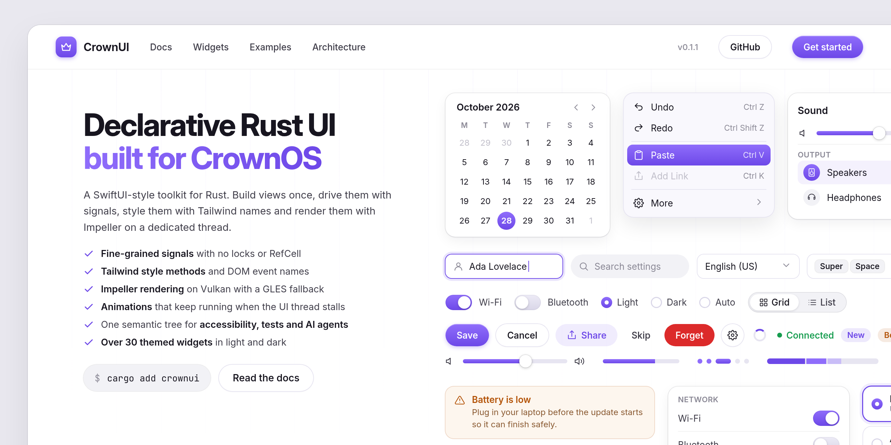

<p align="center">
  
</p>

# CrownUI

CrownUI is a declarative UI toolkit for Rust and the native toolkit of CrownOS. You build views once in a SwiftUI style, drive them with fine-grained signals, style them with Tailwind names and handle DOM-named events. Impeller renders every frame on a dedicated thread, and one semantic tree serves screen readers, tests and AI agents.

```rust
use crownui::prelude::*;

fn main() -> Result<(), crownui::RunError> {
    crownui::run(
        component(|cx| {
            let count = cx.signal(0);
            vstack((
                text(bind(move |rt| format!("Count: {}", count.get(rt)))).text_size(24.0),
                button("+1").on_click(move |cx, _| count.update(cx, |count| *count += 1)),
            ))
            .p(24.0)
            .gap(12.0)
        }),
        AppConfig::new("Counter"),
    )
}
```

## Installation

CrownUI needs Rust 1.97 or newer and runs on Linux under a Wayland compositor.

```sh
cargo add crownui
```

The first build downloads the Impeller SDK (about 23 MB) into `.impeller_cache/`. Set `IMPELLER_CACHE_DIR` to a vendored copy for offline builds, and enable the `static` feature to link Impeller into your binary.

Install the native libraries first.

Debian and Ubuntu:

```sh
sudo apt install build-essential pkg-config libwayland-dev wayland-protocols \
  libxkbcommon-dev libvulkan-dev libegl1-mesa-dev libgbm-dev \
  libfontconfig-dev libfreetype-dev libdbus-1-dev
```

Arch Linux:

```sh
sudo pacman -S base-devel wayland wayland-protocols libxkbcommon \
  vulkan-icd-loader vulkan-headers mesa fontconfig freetype2 dbus
```

### Features

| Feature | Default | What it adds |
|---|---|---|
| `wayland` | yes | The Wayland platform. |
| `impeller` | yes | The Impeller renderer on Vulkan with a GLES fallback. |
| `tokio` | yes | Async tasks through `cx.spawn`. |
| `mcp` | yes | An in-app MCP server so AI agents can drive the app. |
| `accessibility` | yes | Screen reader support through AT-SPI. |
| `static` | no | Links libimpeller statically. |

## Setup from source

The workspace depends on two sibling CrownOS repositories by path, so clone all three side by side.

```sh
mkdir crownos && cd crownos
git clone https://github.com/Crown-OS/crownui.git
git clone https://github.com/Crown-OS/crownos-config.git
git clone https://github.com/Crown-OS/crownos-protocols.git
cd crownui
cargo xtask check
```

`rust-toolchain.toml` pins the toolchain, so rustup installs the right version on the first build. `cargo xtask check` runs clippy, tests and rustfmt on the crates you changed. See [AGENTS.md](AGENTS.md) for every workspace command.

## Examples

| Example | What it shows |
|---|---|
| `counter` | Signals, buttons and hover and press variants. |
| `todo` | Keyed lists, per-row signals, text input and delete actions. |
| `gallery` | Buttons, toggles and a text field in styled sections with dark mode variants. |
| `glass_card` | A canvas gradient behind a backdrop blur card that expands with a spring. |
| `kit_gallery` | The themed CrownOS widgets following the desktop theme. |

Run one with:

```sh
cargo run -p crownui --example counter
```

Render any kit widget to a PNG without opening a window:

```sh
cargo xtask preview --list
cargo xtask preview button_primary --png button.png
```

## Documentation

- [Usage](docs/usage.md) covers views, state, styling, events, the kit, windows, testing and agents.
- [Architecture](docs/architecture.md) explains the crate layers, the two-thread frame pipeline and the semantic tree.
- [Why CrownUI](docs/why-crownui.md) lists what makes CrownUI different.
- [Components](docs/components.md) lists the primitive building blocks and how to write your own.
- [Widgets](docs/widgets.md) lists the themed CrownOS widgets and how theming works.
- [Naming](docs/naming.md) maps Tailwind classes and DOM events to CrownUI methods.
- [Errors](docs/errors.md) indexes every diagnostic code with its fix.
- [Impeller](docs/impeller.md) records how the renderer runs on CrownOS.

Each crate also has its own `README.md` with its public API and invariants.

## License

CrownUI is dual licensed under [MIT](LICENSE-MIT) or [Apache 2.0](LICENSE-APACHE), at your option.
